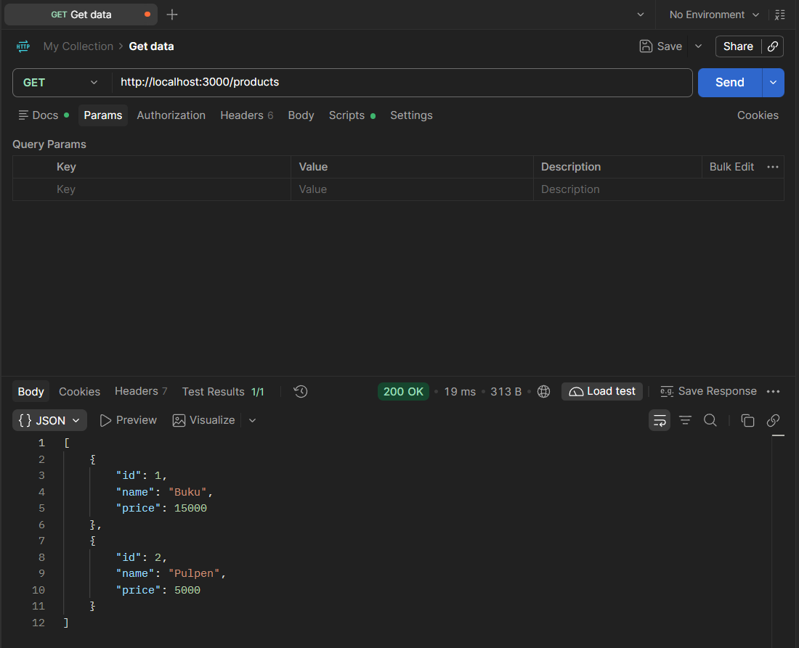
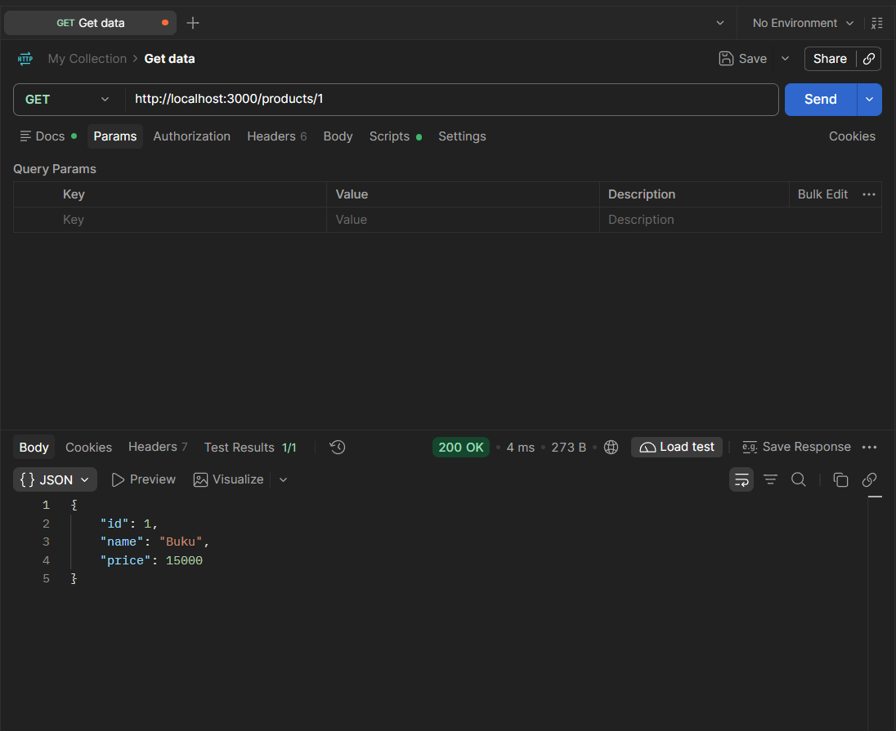
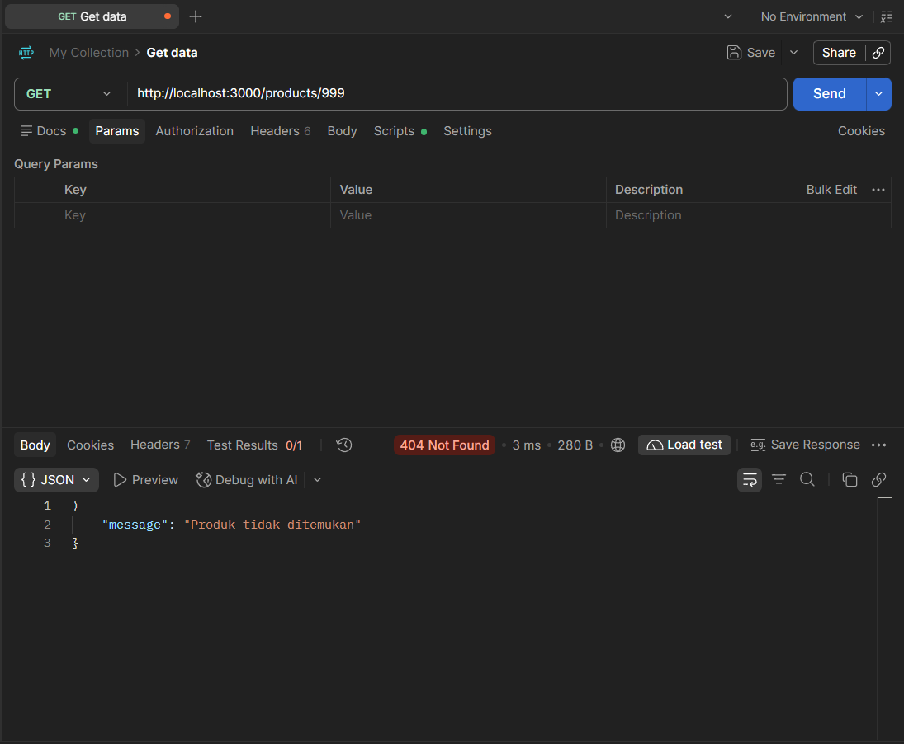
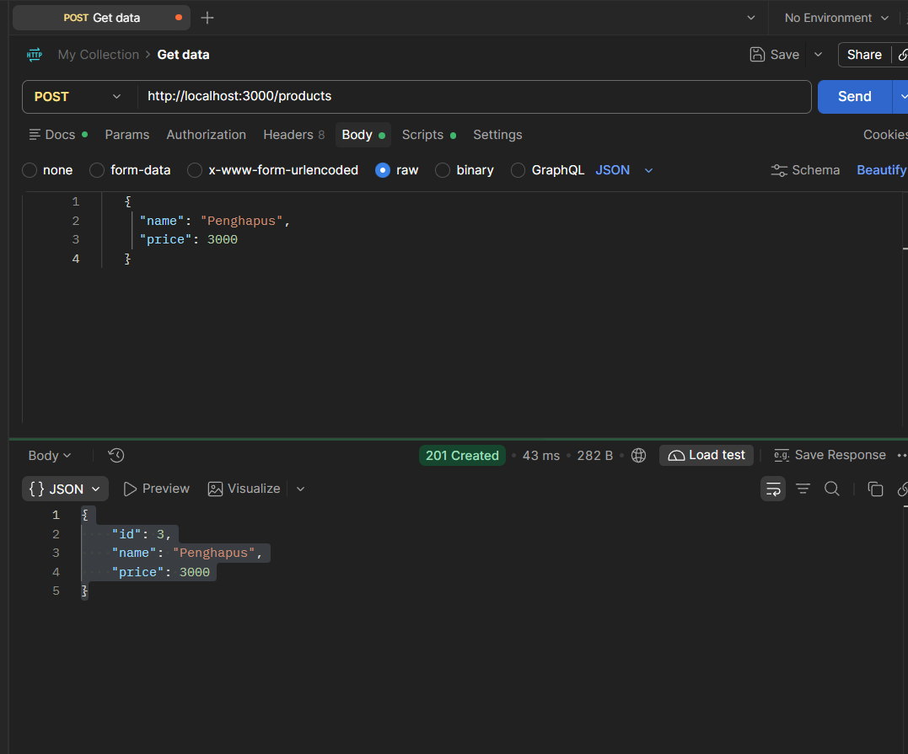
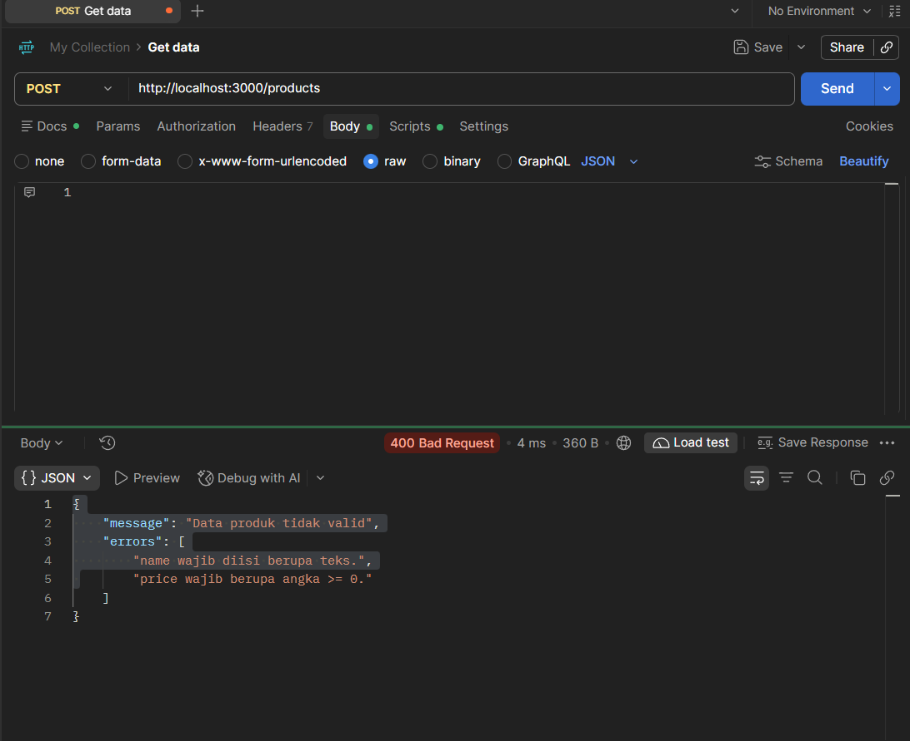
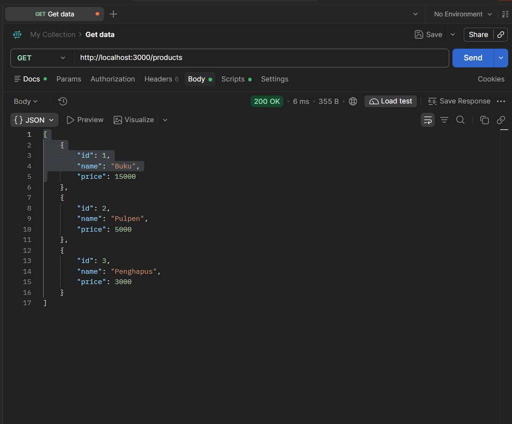

# API Daftar Produk (ExpressJS + TypeScript) | Tugas W9 PemWeb A

##  Dewa Ngakan Gede Wira Adhimukti // 5027251063


## Desikripsi Tugas
Membangun REST API sederhana untuk daftar produk menggunakan ExpressJS dan TypeScript. Data disimpan di array dalam memori (tanpa database), dengan route dan controller yang dipisahkan.

## Fitur

- `GET /products`: mengambil seluruh produk.
- `GET /products/:id`: mengambil satu produk berdasarkan ID.
- `POST /products`: menambah produk baru dengan ID otomatis.
- Validasi dasar untuk `POST /products` (nama wajib teks, harga angka >= 0).
- Respons error dalam format JSON, termasuk 404 untuk produk/endpoint yang tidak ada.

## Struktur Proyek

```
.
├── src
│   ├── app.ts                     # Konfigurasi Express, middleware, pemasangan route
│   ├── server.ts                  # Entry point (menjalankan server)
│   ├── controllers
│   │   └── productController.ts   # Logika request/response produk
│   ├── routes
│   │   └── productRoutes.ts       # Definisi endpoint /products
│   └── data
│       └── products.ts            # Data produk in-memory + operasi data dasar
├── test
│   └── products.test.ts           # Test otomatis seluruh skenario
├── docs
│   └── bukti-pengujian.md         # Bukti pengujian GET, 404, dan POST
├── package.json
├── tsconfig.json
└── README.md
```


## Daftar Endpoint

| Method | Endpoint         | Deskripsi                       | Status Sukses |
| ------ | ---------------- | ------------------------------- | ------------- |
| GET    | `/products`      | Ambil seluruh produk            | 200           |
| GET    | `/products/:id`  | Ambil produk berdasarkan ID     | 200           |
| POST   | `/products`      | Tambah produk baru              | 201           |

### GET /products

```bash
curl http://localhost:3000/products
```

```json
[
  { "id": 1, "name": "Buku", "price": 15000 },
  { "id": 2, "name": "Pulpen", "price": 5000 }
]
```

### GET /products/1

```bash
curl http://localhost:3000/products/1
```

```json
{ "id": 1, "name": "Buku", "price": 15000 }
```

### GET /products/999 (tidak ditemukan)

```bash
curl -i http://localhost:3000/products/999
```

```json
{ "message": "Produk tidak ditemukan" }
```

Status: `404 Not Found`.

### POST /products

```bash
curl -X POST http://localhost:3000/products \
  -H "Content-Type: application/json" \
  -d '{"name":"Penghapus","price":3000}'
```

```json
{ "id": 3, "name": "Penghapus", "price": 3000 }
```

Status: `201 Created`. ID baru dihitung dari ID terbesar yang ada, sehingga tidak bentrok setelah produk ditambahkan.

Jika `name` kosong/bukan teks atau `price` bukan angka >= 0, server membalas `400 Bad Request`:

```json
{
  "message": "Data produk tidak valid",
  "errors": ["name wajib diisi berupa teks.", "price wajib berupa angka >= 0."]
}
```

## Menjalankan Test

```bash
npm test
```

Test memakai test runner bawaan Node.js (`node:test`) dan `fetch`, dijalankan melalui `tsx`. Setiap skenario menguji status code dan isi JSON:

1. `GET /products` → 200 dan seluruh produk.
2. `GET /products/1` → 200 dan objek produk Buku.
3. `GET /products/999` → 404 dan pesan produk tidak ditemukan.
4. `POST /products` → 201 dan produk baru tersimpan.
5. `POST /products` dengan body tidak valid → 400.

Typecheck dijalankan dengan `npm run typecheck`. Build ke folder `dist` dijalankan dengan `npm run build`.


## Hasil Test

Berikut hasil pengujian endpoint melalui Postman. Pastikan server sudah berjalan dengan `npm start`.

### 1. GET /products

Ekspektasi: `200 OK`, `[{"id":1,"name":"Buku","price":15000},{"id":2,"name":"Pulpen","price":5000}]`



### 2. GET /products/1

Ekspektasi: `200 OK`, `{"id":1,"name":"Buku","price":15000}`



### 3. GET /products/999



### 4. POST /products

Ekspektasi: `201 Created`, `{"id":3,"name":"Penghapus","price":3000}`



### 5. POST /products (body tidak valid)

Ekspektasi: `400 Bad Request`, `{"message":"Data produk tidak valid","errors":["name wajib diisi berupa teks.","price wajib berupa angka >= 0."]}`



### 6. GET /products setelah POST

Ekspektasi: `200 OK`, `[{"id":1,"name":"Buku","price":15000},{"id":2,"name":"Pulpen","price":5000},{"id":3,"name":"Penghapus","price":3000}]`


